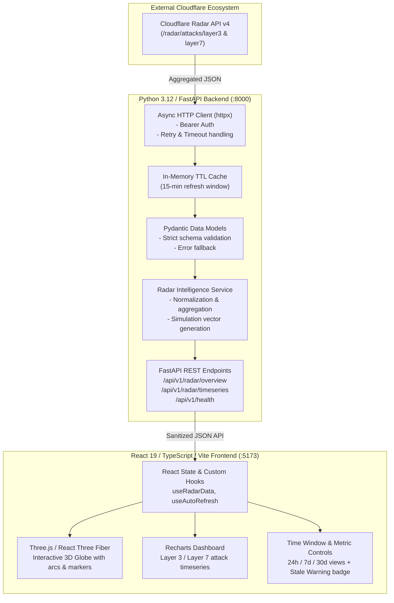

# CyberPulse — Global DDoS Intelligence Globe

> **Real-time aggregated cyber intelligence visualization powered by Cloudflare Radar.**

CyberPulse is an interactive security intelligence platform that transforms aggregated DDoS statistics from Cloudflare Radar into an immersive 3D globe visualization, dynamic temporal charts, and geographic threat intelligence dashboards.

---

## 1. Product Vision & Data Integrity Charter

### Aggregate Truth vs. Simulated Visualizations
- **Genuine Aggregated Data**: Cloudflare Radar provides global, macroscopic DDoS intelligence (e.g., Layer 3/4 and Layer 7 attack trends, top target and origin locations, protocol distributions, and percentage changes over time).
- **Strict Data Integrity Policy**: We **never** fabricate raw incident logs, exact IP coordinates, or individual packet attacks.
- **Simulated Event Representation**: The animated attack arcs and particle pulses rendered on the 3D globe represent **simulated directional flows derived mathematically from aggregated origin-target ratios**. These visualizations are explicitly labeled in the UI as *"Simulated Aggregate Flows"* with corresponding data timestamps, observation windows, and cache status.
- **Stale-Data Handling**: If Cloudflare Radar is unreachable or rate-limited, the system serves cached data marked with a prominent **Stale Data Warning** and last-synced timestamp.

---

## 2. Architecture Overview



---

## 3. Repository Structure

```text
CyberPulse/
├── .gitignore                   # Excludes .venv, node_modules, build artifacts, .env
├── .env.example                 # Template for environment configuration
├── README.md                    # Project blueprint and architecture documentation
├── backend/                     # FastAPI backend application
│   ├── app/
│   │   ├── api/                 # REST endpoints (health, DDoS metrics, aggregates)
│   │   ├── clients/             # Async Cloudflare Radar HTTP client
│   │   ├── core/                # App configuration, logging, and caching
│   │   ├── models/              # Pydantic data schemas
│   │   ├── services/            # Business logic and data transformation
│   │   └── main.py              # Application entrypoint & CORS setup
│   ├── tests/                   # Pytest suite with mocked external responses
│   └── requirements.txt         # Pinned backend dependencies
└── frontend/                    # React + TypeScript + Vite frontend
    ├── src/
    │   ├── components/          # 3D Globe, Charts, Metrics, Header, Alerts
    │   ├── hooks/               # Data fetching, caching, and auto-refresh hooks
    │   ├── services/            # API client for backend communication
    │   ├── styles/              # Design system and glassmorphism styling
    │   ├── types/               # TypeScript interfaces for API payloads & UI
    │   ├── App.tsx              # Root component & dashboard layout
    │   └── main.tsx             # React entrypoint
    ├── tests/                   # Vitest & React Testing Library suites
    ├── package.json             # Pinned frontend dependencies
    ├── tsconfig.json            # TypeScript configuration
    └── vite.config.ts           # Vite build and dev-server configuration
```

---

## 4. Local Development on Windows 11

### Prerequisites
- Python 3.12 (`.venv` virtual environment in root)
- Node.js (v20+ or v24+) & npm
- Git

### Initial Setup
1. **Copy the Environment Template:**
   ```powershell
   Copy-Item .env.example .env
   ```
2. **Configure your Cloudflare Token in `.env`:**
   Open `.env` in your editor and enter your `CLOUDFLARE_API_TOKEN`.

### Running the Backend
```powershell
# Activate the existing virtual environment
.\.venv\Scripts\Activate.ps1

# Install backend dependencies (when in backend milestone)
pip install -r backend/requirements.txt

# Start the FastAPI server with hot-reload
uvicorn app.main:app --reload --host 127.0.0.1 --port 8000 --app-dir backend
```
API Documentation will be accessible at: `http://127.0.0.1:8000/docs`

### Running the Frontend
```powershell
# In a separate terminal, navigate to frontend
cd frontend

# Install frontend dependencies (when in frontend milestone)
npm install

# Start the Vite development server
npm run dev
```
The application will be accessible at: `http://localhost:5173`

---

## 5. Security & Secret Management

- **Zero Secrets on Client**: The frontend never connects directly to Cloudflare. All authentication tokens are kept strictly server-side.
- **Environment Isolation**: `.env` is ignored by Git. Never paste credentials into public chat, logs, or source code.
- **CORS Protection**: The backend explicitly restricts CORS origins to the local Vite development server (`http://localhost:5173`).

---

## 6. Implementation Milestones

| Milestone | Scope | Key Deliverables & Validation Tests |
| :--- | :--- | :--- |
| **M1: Foundation** *(Current)* | Project setup, architecture, Git tracking, security rules | Clean `.gitignore`, `.env.example`, architectural docs, empty repo hygiene verified. |
| **M2: Backend Core & Radar Client** | FastAPI setup, async HTTP client, in-memory cache, Pydantic schemas | Pytest tests for Radar client mocking, TTL cache validation, response parsing, and error fallbacks. |
| **M3: Frontend Shell & Design System** | Vite + React + TS setup, dark cyber theme, metric cards, time range controls | Vitest tests for UI components, responsive layout, and API service layer mocking. |
| **M4: 3D Globe Visualization** | Three.js / React Three Fiber integration, interactive country mapping, simulated flow arcs | Arc trajectory math tests, WebGL fallback tests, performance benchmark (60 FPS target). |
| **M5: Analytics & Temporal Charts** | Recharts timeseries integration, origin vs target breakdowns, protocol summaries | Chart rendering tests, date range filtering, empty/error state coverage. |
| **M6: Polish, Audits & Production Build** | Stale data badges, accessibility checks, automated end-to-end integration | Full test suite pass (`pytest` & `vitest run`), production build verification (`npm run build`). |
