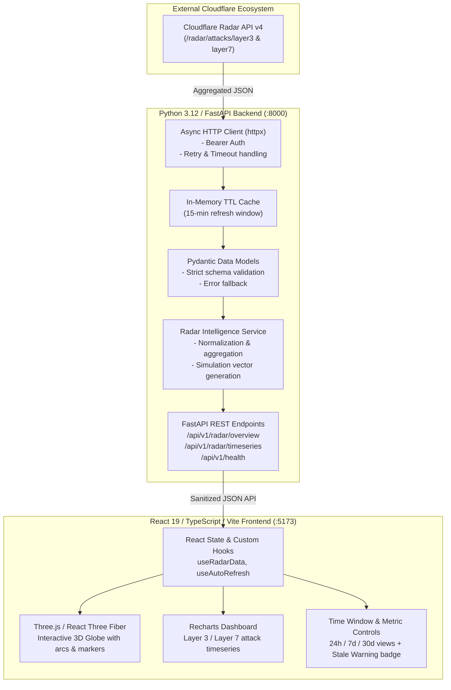

# CyberPulse — Global DDoS Intelligence Globe

> **Real-time aggregated cyber intelligence visualization powered by Cloudflare Radar.**

CyberPulse is an interactive security intelligence platform that transforms aggregated DDoS statistics from Cloudflare Radar into an immersive 3D globe visualization, dynamic temporal charts, and geographic threat intelligence dashboards.

---

## 1. Product Vision & Data Integrity Charter

### Aggregate Truth vs. Simulated Visualizations
- **Genuine Aggregated Data**: Cloudflare Radar provides global, macroscopic DDoS intelligence (e.g., Layer 3/4 and Layer 7 attack trends, top target and origin locations, protocol distributions, and percentage changes over time).
- **Strict Data Integrity Policy**: We **never** fabricate raw incident logs, exact IP coordinates, or individual packet attacks.
- **Simulated Event Representation**: The animated attack arcs and particle pulses rendered on the 3D globe represent **simulated directional flows derived mathematically from aggregated origin-target ratios**. These visualizations are explicitly labeled in the UI as *"Simulated Aggregate Flows"* with corresponding data timestamps, observation windows, and cache status.
- **Stale-Data Handling**: If Cloudflare Radar is unreachable or rate-limited, the system serves cached data marked with a prominent **Stale Data Warning** and last-synced timestamp.

---

## 2. Architecture Overview



---

## 3. Repository Structure

```text
CyberPulse/
├── .gitignore                   # Excludes .venv, node_modules, build artifacts, .env
├── .env.example                 # Template for environment configuration
├── README.md                    # Project blueprint and architecture documentation
├── backend/                     # FastAPI backend application
│   ├── app/
│   │   ├── api/                 # REST endpoints (health, DDoS metrics, aggregates)
│   │   ├── clients/             # Async Cloudflare Radar HTTP client
│   │   ├── core/                # App configuration, logging, and caching
│   │   ├── models/              # Pydantic data schemas
│   │   ├── services/            # Business logic and data transformation
│   │   └── main.py              # Application entrypoint & CORS setup
│   ├── tests/                   # Pytest suite with mocked external responses
│   └── requirements.txt         # Pinned backend dependencies
└── frontend/                    # React + TypeScript + Vite frontend
    ├── src/
    │   ├── components/          # 3D Globe, Charts, Metrics, Header, Alerts
    │   ├── hooks/               # Data fetching, caching, and auto-refresh hooks
    │   ├── services/            # API client for backend communication
    │   ├── styles/              # Design system and glassmorphism styling
    │   ├── types/               # TypeScript interfaces for API payloads & UI
    │   ├── App.tsx              # Root component & dashboard layout
    │   └── main.tsx             # React entrypoint
    ├── tests/                   # Vitest & React Testing Library suites
    ├── package.json             # Pinned frontend dependencies
    ├── tsconfig.json            # TypeScript configuration
    └── vite.config.ts           # Vite build and dev-server configuration
```

---

## 4. Local Development on Windows 11

### Prerequisites
- Python 3.12 (`.venv` virtual environment in root)
- Node.js (v20+ or v24+) & npm
- Git

### Initial Setup
1. **Copy the Environment Template:**
   ```powershell
   Copy-Item .env.example .env
   ```
2. **Configure your Cloudflare Token in `.env`:**
   Open `.env` in your editor and enter your `CLOUDFLARE_API_TOKEN`.

### Running the Backend
```powershell
# Activate the existing virtual environment
.\.venv\Scripts\Activate.ps1

# Install backend dependencies (when in backend milestone)
pip install -r backend/requirements.txt

# Start the FastAPI server with hot-reload
uvicorn app.main:app --reload --host 127.0.0.1 --port 8000 --app-dir backend
```
API Documentation will be accessible at: `http://127.0.0.1:8000/docs`

### Running the Frontend
```powershell
# In a separate terminal, navigate to frontend
cd frontend

# Install frontend dependencies (when in frontend milestone)
npm install

# Start the Vite development server
npm run dev
```
The application will be accessible at: `http://localhost:5173`

---

## 5. Containerization & Docker Deployment

> [!NOTE]
> **Environment Advisory**: The Docker image has **not** yet been built or run in this local development environment, as the Docker runtime is not installed on this host. The multi-stage `Dockerfile` and runtime specifications are verified through static analysis, linters, and comprehensive automated test suites.

### Multi-Stage Docker Build
The production container uses a 2-stage build:
1. **Frontend Builder** (`node:20-alpine`): Installs dependencies with `npm ci` and builds the static SPA bundle into `/dist`.
2. **Production Runtime** (`python:3.12-slim`): Installs Python dependencies, copies backend code and compiled frontend assets, drops privileges to a non-root `cyberpulse` user (`uid=10001`), and binds to `0.0.0.0:$PORT`.

```bash
# Build the production image from project root
docker build -t cyberpulse:latest .
```

### Running the Container Safely
> [!IMPORTANT]
> **Secret Handling**: Never bake `CLOUDFLARE_API_TOKEN` or `.env` files into the image. `.dockerignore` excludes all `.env` files, `.git`, `.venv`, and `node_modules`. Always supply your token at runtime using environment variables or a container orchestrator secret store.

```bash
# Option A: Inject via runtime environment variable
docker run -d \
  --name cyberpulse \
  -p 8000:8000 \
  -e CLOUDFLARE_API_TOKEN="your_cloudflare_api_token_here" \
  cyberpulse:latest

# Option B: Pass local .env file securely (never committed)
docker run -d \
  --name cyberpulse \
  -p 8000:8000 \
  --env-file .env \
  cyberpulse:latest
```

The container automatically serves:
- The compiled React SPA at `/` (with client-side routing fallback).
- REST API endpoints at `/api/v1/*`.
- Interactive Swagger OpenAPI documentation at `/docs`.

---

## 6. Configuration & Environment Variables

| Variable | Type | Default | Description |
| :--- | :--- | :--- | :--- |
| `CLOUDFLARE_API_TOKEN` | Secret String | `None` | Cloudflare API token with Radar read permissions. Optional for offline/mock development; required for live upstream telemetry. |
| `PORT` | Integer | `None` | Dynamic port injected by container platforms (e.g., Cloud Run, Render, Railway). Overrides `BACKEND_PORT` when set. |
| `BACKEND_HOST` | String | `127.0.0.1` | Network interface binding (`0.0.0.0` in container). |
| `BACKEND_PORT` | Integer | `8000` | Port for the backend Uvicorn server. |
| `BACKEND_CORS_ORIGINS` | Comma-separated | `http://localhost:5173,http://127.0.0.1:5173` | Allowed CORS origins. Wildcard `*` is supported safely since `allow_credentials=False`. |
| `BACKEND_RATE_LIMIT_PER_MINUTE` | Integer | `60` | Maximum requests per minute per client IP for `/api/v1/*` routes. |
| `TRUSTED_PROXIES` | Comma-separated | `[]` | List of trusted reverse proxy IPs or CIDR blocks (e.g. `127.0.0.1,10.0.0.0/8`). Required for safe `X-Forwarded-For` resolution. |
| `CACHE_TTL_SECONDS` | Integer | `900` | Fresh cache TTL for complete upstream responses (15 minutes). |
| `CACHE_MAX_STALE_SECONDS` | Integer | `86400` | Maximum retention window for stale fallback during upstream outages (24 hours). |
| `CACHE_PARTIAL_TTL_SECONDS` | Integer | `30` | Short-lived cache TTL for partial upstream responses to prevent request amplification. |
| `RADAR_REQUEST_TIMEOUT_SECONDS` | Float | `15.0` | Upstream Cloudflare Radar HTTP request timeout. |
| `RADAR_MAX_RETRIES` | Integer | `2` | Upstream retry count on transient network errors or 5xx responses. |
| `FRONTEND_DIST_DIR` | String | Autodetected | Path to frontend distribution directory or `none` to run in API-only mode. |

---

## 7. Health Probes & Monitoring

The service exposes standardized health endpoints for load balancers, orchestrator liveness/readiness probes, and monitoring:
- **Root Health Check**: `GET /health` -> `{"status": "ok"}` (standard container probe).
- **API v1 Health Check**: `GET /api/v1/health` -> `{"status": "ok"}`.
- **Detailed Radar Status**: `GET /api/v1/radar/status` -> upstream synchronization status, cache statistics, and active warnings.

> [!NOTE]
> Both `/health` and `/api/v1/health` are **fully exempt** from rate limiting and require no authentication, ensuring monitoring systems are never throttled.

---

## 8. Reliability, Rate Limiting & Proxy Architecture

### Sliding-Window Rate Limiter
- **Sliding-Window Log**: Tracks client request timestamps in a sliding 60-second window. Requests exceeding `BACKEND_RATE_LIMIT_PER_MINUTE` return HTTP `429 Too Many Requests` along with a standard `Retry-After` header indicating the wait time in seconds.
- **Single-Process Limitation**: The rate limiter is implemented in process memory. In single-container deployments, it strictly limits requests per instance. In multi-worker or horizontally scaled clusters, each worker enforces its own window; for distributed enforcement across multiple nodes, a centralized cache (such as Redis) should be introduced.
- **Memory Bounded**: Inactive client records are automatically pruned every 30 seconds and when tracking capacity approaches thresholds, preventing unbounded memory growth.

### Safe Proxy & Client IP Resolution
- Arbitrary client-supplied `X-Forwarded-For` headers are **never blindly trusted**.
- If the direct peer connection does not originate from a configured `TRUSTED_PROXIES` address or CIDR range, `X-Forwarded-For` is ignored and the direct socket peer IP is used.
- When behind trusted reverse proxies (e.g., Cloudflare CDN, AWS ALB, Nginx), proxy hops are evaluated right-to-left to safely extract the authentic client IP.

### Partial-Response Request Amplification Protection
- If Cloudflare Radar suffers a partial degradation (e.g. 1 out of 5 endpoints fails), the backend normalizes and preserves the successful dimensions with status `PARTIAL`.
- A dedicated, short-lived 30-second cache (`CACHE_PARTIAL_TTL_SECONDS`) stores partial responses to prevent repetitive client polling from hammering the degraded upstream service (single-flight and request amplification protection).
- Partial responses never overwrite existing fresh (900s) or stale (24h) full responses. Once upstream recovers, complete responses immediately take precedence.

---

## 9. Security & Secret Management

- **Zero Secrets on Client**: The frontend never connects directly to Cloudflare. All authentication tokens are kept strictly server-side.
- **Environment Isolation**: `.env` is ignored by Git and Docker. Never paste credentials into public chat, logs, or source code.
- **CORS Hardening**: `allow_credentials` is set to `False` for stateless token security, preventing credential leakage and permitting wildcard `*` origins without startup errors.
- **Log Sanitization**: A custom logging filter intercepts and masks sensitive tokens, Authorization headers, and bearer credentials from stdout.

---

## 10. Implementation Milestones

| Milestone | Scope | Status | Key Deliverables & Validation Tests |
| :--- | :--- | :--- | :--- |
| **M1: Foundation** | Project setup, architecture, Git tracking, security rules | Completed | Clean repository hygiene, `.gitignore`, `.env.example`, architectural docs. |
| **M2: Backend Core & Radar Client** | FastAPI setup, async HTTP client, in-memory cache, Pydantic schemas | Completed | Pytest tests for Radar client mocking, TTL cache validation, response parsing, and error fallbacks. |
| **M3: Frontend Shell & Design System** | Vite + React + TS setup, dark cyber theme, metric cards, time range controls | Completed | Vitest tests for UI components, responsive layout, and API service layer mocking. |
| **M4: 3D Globe Visualization** | Three.js / React Three Fiber integration, interactive country mapping, simulated flow arcs | Completed | Arc trajectory math tests, WebGL fallback tests, performance benchmark. |
| **M5: Analytics & Temporal Charts** | Recharts timeseries integration, origin vs target breakdowns, protocol summaries | Completed | Chart rendering tests, date range filtering, empty/error state coverage. |
| **M6: Polish, Audits & Production Build** | Stale data badges, accessibility checks, automated end-to-end integration | Completed | Full test suite pass (`pytest` & `vitest run`), production build verification (`npm run build`). |
| **M7: Reliability & Data Quality** | Partial failure preservation, bounded stale cache, public warning sanitization | Completed | 38 backend tests, 126 frontend tests, strict zero-placeholder validation. |
| **M8 Phase 1: Containerization** | Multi-stage Dockerfile, static SPA serving, dynamic PORT binding | Completed | Container build specification, frontend static resolution, 41 backend tests, 129 frontend tests. |
| **M8 Phase 2: Deployment Hardening** | Sliding-window rate limiter, CORS hardening, partial cache amplification protection | Completed | 55 backend tests, 129 frontend tests, safe proxy IP resolution, Retry-After headers, documentation. |
